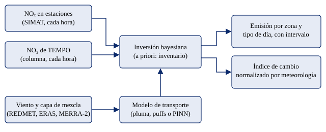
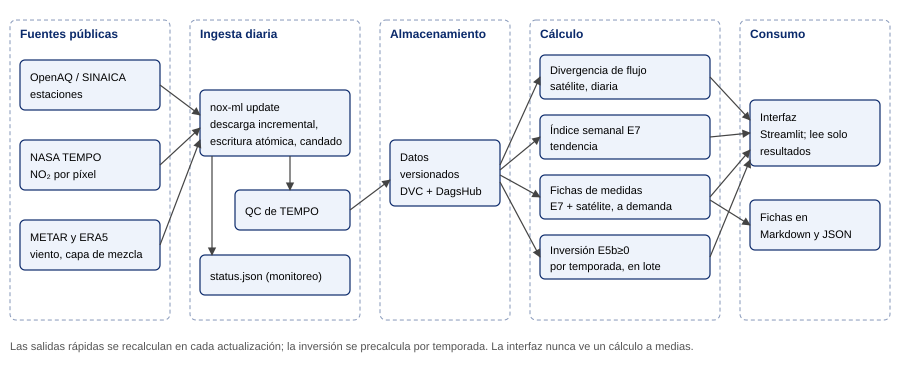

# Resumen

Las autoridades de la Zona Metropolitana del Valle de México (ZMVM) evalúan sus medidas contra la contaminación con concentraciones, que mezclan emisión y ventilación, y con un inventario que se publica cada varios años. Este proyecto estima la emisión de óxidos de nitrógeno (NOₓ) de arriba hacia abajo, con 24 estaciones de monitoreo, el satélite TEMPO de la NASA y la meteorología, y la separa del clima. Siguiendo CRISP-ML(Q), se compararon un baseline de inversión bayesiana, ocho modelos y seis ensambles con la misma validación (error en una estación oculta y placebo de días sin cambio), y se evaluó el modelo final en un periodo de prueba y en cuatro temporadas no vistas de 2024–2026. La inversión final (puffs con transporte aprendido por una red informada por la física y emisión no negativa) iguala a la interpolación en concentración (11.7 frente a 11.6 ppb), no inventa cambios (placebo 0.95–1.11) y da un domingo/hábil de 0.42–0.52, cercano al del satélite (0.49–0.61). Para medir cambios se implementa un estimador normalizado por meteorología, validado con el confinamiento de 2020 (−50 %; esperado −40 a −60 %), con rango calibrado (91 % de cobertura) y una segunda opinión del satélite. El sistema detecta cambios grandes y sostenidos (≥ 30 % en una temporada), pero una deriva lenta de ±15 % impide ver los cambios de 5–10 % de las medidas reales. Se propone una operación automática con datos públicos; la principal vía de mejora son los datos de actividad vehicular.

**Palabras clave:** NOₓ, problema inverso, PINN, TEMPO, normalización meteorológica, Ciudad de México.

# 1. Contexto de negocio y problema

## 1.1 El problema

Los NOₓ (NO + NO₂) se forman en la combustión; en la ZMVM la fuente dominante es el transporte. El NO₂ irrita las vías respiratorias y es precursor del ozono y de partículas finas (World Health Organization, 2021). Las herramientas actuales no responden a una pregunta concreta: *¿cuánto cambió la emisión de NOₓ esta semana, o con esta medida?* (Tabla 1).

Tabla 1. Herramientas actuales y su limitación para evaluar cambios de emisión.

| Herramienta | Qué hace | Limitación |
|---|---|---|
| Inventario de emisiones (SEDEMA, 2018) | Actividad × factor de emisión, en t/año | Estimación, no medición; se publica cada varios años con retraso (la edición 2018 salió en 2021) |
| Monitoreo (SIMAT) | Concentraciones horarias en ~30 estaciones | La concentración mezcla emisión y ventilación |
| Pronóstico químico | Predice concentraciones | Supone las emisiones del inventario; no las estima |
| Evaluación antes/después | Compara concentraciones entre periodos | Se confunde cuando cambia la meteorología |

El caso crítico son las contingencias ambientales, que se declaran justo en los días de peor ventilación: con solo concentraciones no se distingue entre "la medida no redujo la emisión" y "la redujo, pero el aire estancado lo ocultó" (Davis, 2008).

**Tarea de aprendizaje automático.** Dados el NOₓ de las estaciones, la columna de NO₂ de TEMPO y la meteorología, estimar la emisión de NOₓ (por zona y tipo de día) y sus cambios, con incertidumbre. No hay etiquetas de emisión: es una variable latente, lo que convierte la tarea en un **problema inverso** (Tarantola, 2005; Rodgers, 2000).

## 1.2 Beneficiario y usuarios

El beneficiario es el Hub de Ciencia de Datos del Tecnológico de Monterrey, que recibe un método reproducible con código, datos versionados y documentación. El patrocinador es el Dr. Juan Arturo Nolazco Flores. Todas las fuentes son públicas.

## 1.3 Cambio de enfoque adoptado

La propuesta inicial (Avance 0) planteaba **evaluar si cada contingencia redujo la emisión, por zona y en toneladas**. Los resultados de los avances 4 y 5 obligaron a replantearlo (Tabla 2).

Tabla 2. Enfoque inicial frente a enfoque adoptado.

| Aspecto | Avance 0 | Enfoque adoptado |
|---|---|---|
| Pregunta | ¿Redujo la emisión cada contingencia? | ¿Fue clima o emisión en cada episodio? ¿Funciona una medida sostenida? |
| Salida principal | Toneladas por zona | Cambio relativo con rango, placebo y límite de detección |
| Modelo que responde | Inversión con PINN | Estimador normalizado (E7) con segunda opinión del satélite; la inversión da el reparto entre zonas |
| Usuario | SEDEMA y CAMe | Roles: autoridad ambiental, evaluador independiente, periodista de datos, financiador, planeador de transporte, equipo de inventario e investigador |

Las razones: con 9 días hábiles de contingencia el sistema detecta bajas de ~20 % o más, mientras el efecto esperado del Doble Hoy No Circula es de 5–10 %; las toneladas cambian ×2 según el modelo de transporte; y el sistema no depende de ninguna institución, porque cualquiera puede correrlo con datos públicos.

## 1.4 Objetivos y criterios de éxito

Tabla 3. Objetivos específicos, criterio y resultado.

| # | Objetivo | Criterio | Resultado |
|---|---|---|---|
| 1 | Datos con calidad verificada | QC por fuente, datos versionados | Cumplido (DVC + DagsHub) |
| 2 | Baseline reproducible | r = 0.77/0.74; LOO 13.6 ppb; domingo 0.42 | Cumplido (13.59 ppb; 0.42) |
| 3 | ≥ 6 modelos comparados | Tabla por error LOO con métricas adicionales | Cumplido (8 modelos, 6 ensambles) |
| 4 | No inventar cambios | Placebo en 1 ± 0.15 | Cumplido en todos los periodos |
| 5 | Cambio de respuesta conocida | Domingo coherente con la referencia | Parcial: coincide con el satélite, no con el tráfico contado (sección 4.3) |
| 6 | LOO cercano al piso de interpolación | No muy por encima de IDW (11.6 ppb) | Cumplido (11.7 ppb) |
| 7 | Evaluación en datos no vistos | Prueba y prueba ciega con intervalo | Cumplido (feb–may 2024 y 4 temporadas 2024–2026) |
| 8 | Comunicar resultados y límites | Fichas con intervalos | En curso (fichas listas; interfaz pendiente) |

# 2. Datos y preparación

## 2.1 Fuentes

Tabla 4. Fuentes de datos.

| Fuente | Periodo | Resolución | Uso |
|---|---|---|---|
| SIMAT (RAMA, REDMET): NO, NO₂, NOₓ, viento | 2019–2020, 2023–2024 | Horaria, 24 estaciones con NOₓ | Observación principal |
| OpenAQ (SINAICA, sin validar) | 2024–2026 | Horaria, mismas estaciones, 60–65 % de las horas | Temporadas posteriores a 2024 |
| TEMPO NO₂ L2 V04 (NASA) | Nov 2023–2026 | Píxel ~2 × 4.5 km, ~1 escaneo por hora en la tarde | Segunda observación y estimación independiente |
| METAR (MMMX, MMSM) | 2019–2026 | Horaria | Viento desde 2025 |
| ERA5 (Open-Meteo), MERRA-2 | 2019–2026 | Horaria | Altura de la capa de mezcla |
| OpenStreetMap, Infovial | 2017, 2026 | Por vía | Reparto espacial de la emisión vial; tráfico contado |
| Inventario SEDEMA 2018, EDGAR, Climate TRACE, DENUE | 2018–2026 | Anual | Solo punto de partida (a priori) y comparación |
| Contingencias (SEDEMA, PCAA) | 2023–2026 | Episodios | Excluir días atípicos de la referencia |

El dominio mide 3,260 km² (19.25–19.77 °N, 99.35–98.81 °O). Todo el análisis usa las tardes (12–17 h local), cuando la capa de mezcla está desarrollada y TEMPO observa.

## 2.2 Calidad y limpieza (Avance 1)

- **Viento de REDMET 2024 en mph etiquetado como m/s** (2.2× mayor): se corrigió dividiendo entre 2.237, conservando el valor original. Fue el problema más grave.
- **Sensores atascados:** 59 horas enmascaradas, sin efecto en los periodos de estudio.
- **TEMPO:** de 165,082 píxeles de nov–dic 2023, las nubes rechazan 43.9 %, las banderas de calidad 19.2 %; quedan 78,240 válidos (47.4 %). Se usa por píxel, sin exigir cobertura del dominio.
- **Capa de mezcla de 2024:** ERA5 tiene huecos; se rellenó con MERRA-2 corregido por hora local (error mediano fuera de muestra de 340 m, 12 %).
- **No se imputa el NOₓ:** una hora sin dato no entra.

Hallazgos exploratorios: el nivel de NOₓ varía 4.6 veces entre estaciones; la capa límite explica más que el viento; el domingo crudo es 44 % menor que el día hábil, pero ese cociente mezcla clima y emisión. TEMPO correlaciona 0.77 con el NO₂ de superficie y es casi insensible a la capa límite: es complementario a las estaciones.

## 2.3 Ingeniería de características (Avance 2)

En los modelos físicos las "características" son la matriz de transporte; en el modelo estadístico (bosque aleatorio, E6) se construyeron con justificación física: ventilación (viento × capa de mezcla) y su acumulado de 3 y 6 h, hora y día en forma cíclica, dirección del viento en seno y coseno, tipo de día y un proxy de emisión vial de OpenStreetMap (Spearman 0.71 con el nivel de las estaciones). El objetivo de E6 se transforma a logaritmo (la varianza que dominan los valores altos baja de 44 % a 14 %, y un cambio de emisión se vuelve un desplazamiento). La PINN usa la ecuación de advección-difusión adimensional.

Las tres fuentes se integran con una sola convención de tiempo (hora de inicio, UTC) y una malla UTM. El periodo de prueba (feb–may 2024) no se carga en el ajuste: la herramienta de ajuste rechaza configuraciones que lo incluyan.

# 3. Metodología y modelos

## 3.1 Formulación

Para cada hora, la concentración observada y (estaciones y píxeles) se relaciona con la emisión e de cada zona por una matriz de transporte J que depende del viento y de la capa de mezcla:

y = J e + b + ε,  e ~ N(e₀, Σ₀),  ê = e₀ + Σ₀Jᵀ (JΣ₀Jᵀ + R)⁻¹ (y − J e₀)

donde b es el fondo y R la covarianza del error. El inventario solo fija e₀, igual para todos los tipos de día, así que cualquier diferencia entre días sale de los datos. Los modelos difieren en cómo construyen J (el transporte) o en cómo estiman la emisión.

<figure>

</figure>

Figura 1. Esquema del método: de las mediciones y la meteorología a la emisión por zona y al índice de cambio.

## 3.2 Validación común

Todos los modelos cumplen un mismo contrato y se evalúan igual:

- **Métrica principal:** error al predecir una estación oculta (`loo_rmse_ppb`). Mide si la física y la emisión estimada explican lo que se mide donde no hay sensor.
- **Compuerta de elegibilidad:** placebo de días hábiles reetiquetados al azar, centrado en 1 ± 0.15. Un modelo que inventa cambios queda fuera aunque tenga buen error. El semiancho del placebo es el cambio mínimo detectable.
- **Cambio de respuesta conocida:** cociente domingo/hábil frente a una referencia.
- **Referencias de concentración, no candidatas:** IDW (11.6 ppb) y kriging (10.3 ppb). No estiman emisión, pero marcan el piso.
- **Datos no vistos en tres niveles:** validación (nov–dic 2023, donde se decidió todo), prueba (feb–may 2024, una sola vez con la configuración congelada) y prueba ciega (cuatro temporadas de 2024–2026 con otra red y otro viento).

## 3.3 Baseline (Avance 3)

Inversión bayesiana lineal con pluma gaussiana estacionaria, malla de 3 × 3 regiones de ~18 km y un viento por hora para el dominio. Solución cerrada, ~12–14 s por ajuste.

Resultado: placebo 1.08 ± 0.35 (pasa), domingo 0.42 (IC 90 % 0.35–0.54) y LOO 13.6 ppb, 17 % peor que IDW. Pasa el desempeño mínimo pero subajusta, depende críticamente de TEMPO (sin él el domingo sube a 0.80) y su placebo de ±0.35 solo distingue cambios mayores a ~35 %.

## 3.4 Candidatos (Avance 4)

Ocho modelos con algoritmos distintos, todos con emisión como salida (Tabla 5).

Tabla 5. Modelos candidatos en nov–dic 2023 (validación).

| # | Modelo | Algoritmo | LOO (ppb) | Domingo/hábil | Placebo (centro ± semiancho) | Ajuste (s) |
|---|---|---|---|---|---|---|
| E5b | `pinn_puff` | Inversión con puffs y núcleo aprendido por PINN | **11.87** | 0.48 | 1.01 ± 0.12 | 529 |
| E5a | `pinn_plume` | Inversión con pluma y núcleo PINN | 12.49 | 0.42 | 1.09 ± 0.33 | 16 |
| E2 | `inversion_puff` | Inversión con puffs analíticos y vida química por OH | 12.50 | 0.52 | ± 0.16 | 323 |
| E3 | `regularized_ls` | Mínimos cuadrados regularizados y no negativos | 13.57 | — | ± 0.33–0.35 | 1–16 |
| E1 | baseline | Inversión bayesiana con pluma estacionaria | 13.59 | 0.42 | 1.08 ± 0.35 | 12–14 |
| E4 | `lognormal_map` | Máximo a posteriori log-normal | 13.59 | — | ± 0.33–0.35 | 1–16 |
| E6 | `rf_deweather` | Normalización meteorológica con bosque aleatorio | 14.61 | 0.53 | 0.97 ± 0.09 | 1 |
| E7 | `normalized_ratio` | Estimador normalizado (observado ÷ esperado) | 16.75 | — | 0.88 | 0 |
| — | IDW / kriging | Referencias de concentración | 11.57 / 10.33 | — | — | — |

Lectura:

- **El transporte con memoria es la palanca.** Los puffs bajan ~1.1 ppb el error del baseline y estrechan el placebo de ±0.33–0.35 a ±0.12–0.16, a cambio de ~35 veces más tiempo. El núcleo aprendido por la PINN aporta menos (E5a gana ~1.1 ppb a la pluma analítica, E5b ~0.6 ppb a E2).
- **Los ocho pasan el placebo** (centros 0.88–1.09).
- **Ninguno supera al kriging**; E5b queda a 0.30 ppb de IDW.
- **El nivel absoluto depende del transporte:** con las mismas observaciones, la emisión vial de un día hábil va de 30,403 t/año (E5b) a 59,786 t/año (E2), un factor de 2. Por eso las conclusiones se apoyan en cocientes.
- **La PINN se entrena solo con la ecuación**, sin datos de estaciones, de modo que no puede filtrar información de la estación oculta.

## 3.5 Ensambles y modelo final (Avance 5)

Se construyeron seis ensambles: bagging de E5b (X1), ensamble de vientos sobre E2 (X2), semillas de la PINN (X3), gradient boosting en lugar del bosque (X4), stacking (X5) y promedio bayesiano (X6) de E5b, E2 y E5a. Las diferencias se midieron con un bootstrap pareado por estación (4,000 réplicas): una diferencia cuyo IC 95 % incluye el 0 no es mejora (Tabla 6).

Tabla 6. Diferencia de error frente a E5b (11.87 ppb), nov–dic 2023.

| Modelo | Diferencia (ppb) | IC 95 % | Estaciones donde gana |
|---|---|---|---|
| X1 bagging | +0.01 | [−0.03, +0.05] | 12/24 |
| X3 semillas | 0.00 | [−0.01, +0.01] | 8/24 |
| X6 promedio bayesiano | 0.00 | (es E5b) | 0/24 |
| X5 stacking (anidado) | +0.12 | [−0.03, +0.36] | 14/24 |
| **E5b≥0 (emisión ≥ 0)** | **−0.16** | [−0.41, +0.04] | 15/24 |
| X2 vientos | +0.50 | [−0.16, +1.23] | 9/24 |
| E2 puffs | +0.63 | [−0.17, +1.63] | 10/24 |
| E1 baseline | +1.72 | [+0.94, +2.53] | 1/24 |
| Kriging | −1.54 | [−2.35, −0.79] | 18/24 |

**Ningún ensamble mejora a E5b de forma significativa.** Los homogéneos promedian un modelo lineal y estable; los heterogéneos combinan modelos que comparten datos, viento y fondo, y fallan en las mismas horas.

Con criterios fijados antes de ver la tabla (pasar el placebo; menor error; en empate, emisión absoluta por zona, luego placebo más estrecho, luego costo), el **modelo final de inversión es E5b≥0** (`pinn_puff_nonneg`): E5b con la restricción de que ninguna emisión sea negativa, resuelta como mínimos cuadrados acotados de ~30 incógnitas en milisegundos. Mismo error (11.7 ppb), mismo domingo (0.48), el placebo más estrecho (±0.11) y sin las regiones negativas que daba E5b (el suroeste, −1,780 t/año).

**El estimador de cambios (E7).** E7 no compite en concentración (16.75 ppb) porque no está hecho para eso: divide el NOₓ observado entre el esperado con emisión fija y meteorología real, y reporta el cociente entre grupos de días. Es el único estimador validado con un cambio real conocido (sección 4.2) y responde en ~1–2 min, frente a ~9 min de E5b y 1–2 h de una inversión completa de 4 meses. Por eso es el motor de las fichas de medidas.

# 4. Resultados y validación

## 4.1 Desempeño en datos no vistos

Tabla 7. Modelo final frente a alternativas en datos no vistos. LOO en ppb; domingo ÷ hábil sin periodos atípicos.

| Temporada | Nivel | E5b≥0 | E2 | IDW | E5b + kriging | Domingo E5b≥0 | Domingo satélite |
|---|---|---|---|---|---|---|---|
| nov–dic 2023 | Validación | 11.71 | 12.50 | 11.6 | 10.19 | 0.48 | 0.55 |
| feb–may 2024 | Prueba | 7.6 | — | 7.1 | 6.7 | 0.50 | 0.51 |
| nov–dic 2024 | Prueba ciega | 11.34 | 12.06 | 11.9 | 10.84 | 0.51 | 0.60 |
| feb–may 2025 | Prueba ciega | 6.77 | 7.07 | 6.4 | 6.11 | 0.49 | 0.61 |
| nov–dic 2025 | Prueba ciega | 10.06 | 10.47 | 9.7 | 8.97 | 0.42 | 0.57 |
| feb–may 2026 | Prueba ciega | 7.11 | 7.37 | 7.1 | 6.23 | 0.52 | 0.53 |

- **El error se sostiene fuera de muestra.** E5b≥0 queda a ±0.5 ppb de IDW en todas las temporadas y le gana a E2 en las cuatro de la prueba ciega. El error baja en primavera por más ventilación (capa de mezcla mediana de ~2,500 m frente a ~1,270 m), no porque el modelo sea mejor. El híbrido con kriging de los residuos es el mejor en todas.
- **No inventa cambios:** placebo de 0.95 a 1.11 en las cuatro temporadas ciegas y 1.07 ± 0.15 en la prueba.
- **Sin emisiones imposibles:** ninguna región negativa en ninguna temporada.
- **Debilidad:** el domingo varía entre temporadas (0.42–0.52) y queda 0.09–0.15 debajo del satélite en tres de cuatro temporadas ciegas.

**Advertencia de limpieza.** Feb–may 2024 no es una prueba del todo limpia: el piso de viento de E5b y el replanteamiento del caso de uso se decidieron mirando datos de 2024. La evaluación que cuenta es la prueba ciega.

## 4.2 Validación con cambios reales y con verdad conocida

Tabla 8. Validación de E7, el estimador de cambios.

| Prueba | Resultado | Referencia |
|---|---|---|
| Confinamiento de 2020 frente a 2019 | −50 % | Esperado −40 a −60 % |
| Placebo de 2019 (sin confinamiento) | ~1 | Sin cambio |
| Placebos de 2019, 2023 y 2024 | 1 ± 0.15 | Sin cambio |
| 6 temporadas 2023–2026 | Placebo 0.91–1.11 | Sin cambio |
| Rango de las fichas (960 inyecciones de 0 y 20 % en 4 temporadas) | 91 % de cobertura al 90 %, 5 % de falsas alarmas | 90 % y ≤ 10 % |
| Bootstrap por bloques de 7 días en gemelos con verdad conocida | 85 % de cobertura al 90 % | Antes ~60 % |

**Segunda opinión del satélite.** La emisión de la ciudad estimada solo con TEMPO, por divergencia de flujo (Beirle et al., 2011), no usa el NOₓ de las estaciones. Da un domingo de 0.58 (0.54–0.61) con seis temporadas, con su placebo en 1.00. Calibrada con ~1,100 inyecciones, cubre la verdad el 87–98 % de las veces con 2–13 % de falsas alarmas. En una prueba detectó una falsa alarma de E7 (E7 +34 %, satélite −17 %). No es del todo independiente de E7: después de 2024 comparte el viento de los aeropuertos y la capa de mezcla.

## 4.3 La referencia del domingo

El plan original juzgaba el domingo contra el tráfico contado en vialidades primarias (0.65–0.73; 0.76–0.81 en la tarde). Todos los modelos quedaban debajo (0.42–0.56). Dos referencias independientes, hechas después de elegir el modelo, mostraron que el problema era la referencia: el satélite solo da 0.58 y el CO como trazador de la actividad da 0.56–0.74 en 2023–2024. Las vialidades primarias no representan la emisión de toda la zona metropolitana. Como satélite, CO y modelos miden concentración o columna, no se descarta del todo un sesgo común.

## 4.4 Límite de detección y la deriva lenta

El hallazgo más importante para el negocio: **cuánto tiene que cambiar la emisión para que el sistema lo vea.**

Tabla 9. Cambio mínimo detectable (80 % de potencia, 90 % de confianza).

| Tipo de medida | Días | Mínimo detectable |
|---|---|---|
| Días sueltos (contingencias) | 9 | 27–40 % según la temporada |
| Días seguidos, una temporada | 9 | 39–47 % |
| Días seguidos, una temporada | 60 | 32–34 % |
| Días seguidos, seis temporadas | 20 por temporada | ~17 % si la deriva es independiente entre años; 22–26 % si se repite (correlación 0.25–0.5) |

La causa es una **deriva lenta**: semanas enteras en que la emisión estimada sube o baja ±15 % sin que el clima lo explique. La ven dos métodos independientes (E7 y el satélite) y es de toda la ciudad: las estaciones del oriente y del poniente suben y bajan juntas. Se probaron cinco correcciones y ninguna la quita: corregir por clima fuera de temporada, combinar E7 con el satélite, contrastar zonas, corregir por la afluencia del transporte público (que varía solo 1–3 % por semana, contra 17–28 % de E7) y usar escaneos matutinos de TEMPO. Recalibrada sin el periodo reservado, la deriva sale 0.13; se conserva 0.15 como valor conservador.

## 4.5 Qué significan los errores para el negocio

- **Un error de ~11 ppb en concentración** (≈ el de interpolar) significa que el modelo explica lo que se mide donde no hay estación tan bien como la mejor alternativa simple, pero no mejor. Su valor no está en predecir concentración, sino en salir de un modelo que también explica la emisión.
- **Un placebo de ±11–15 %** significa que el modelo no "ve" cambios que no existen más allá de ese margen. Una afirmación pública de reducción menor a ese margen no se puede respaldar ni refutar.
- **Un mínimo detectable de ~30 % por temporada** significa que una medida sostenida que reduce 5–10 % la emisión, la escala típica de las medidas reales, **no se puede verificar hoy** con este método, ni con varias temporadas. Lo que sí se puede: medidas o choques grandes (≥ 20–30 %), descartar afirmaciones exageradas y separar clima de emisión en un episodio.
- **El factor ×2 en toneladas** significa que el sistema no sirve para auditar el total de un inventario, pero sí su reparto relativo. El oriente (la columna este del dominio: Chalco, Ixtapaluca, Chimalhuacán, Texcoco y el oriente de Iztapalapa) concentra 5–10 % de la emisión vial según la inversión y 9–15 % según el satélite, frente a 13–17 % del inventario vial municipal del INECC (MOVES-México 2016) y de EDGAR. Las dos estimaciones de arriba hacia abajo quedan debajo de las fuentes oficiales, pero la brecha (4–10 puntos) es del tamaño de la incertidumbre por la dirección del viento: es una señal para revisar, no una auditoría.

Tabla 10. Capacidades: para qué alcanza hoy.

| Capacidad | Estado | ¿Aporta valor? |
|---|---|---|
| Cambio de emisión entre periodos (E7) | Validado para cambios grandes | Alto |
| No inventar cambios (placebo) | Validado | Alto, para verificación |
| Límite de detección por número de días | Validado con inyecciones | Medio–alto: planear pilotos |
| Incertidumbre calibrada | Validada | Medio; da confianza a lo demás |
| Diagnóstico de episodios (¿lo explica el clima?) | Validado en 52 episodios de causa conocida: no se equivoca de causa en 49; no afirma cambios de emisión | Medio |
| Cambios moderados (5–20 %) | Fuera de alcance por la deriva | Bajo hoy |
| Concentración sin estación | Empata con interpolación | Bajo como producto aparte |
| Emisión por zona | Solo proporción en 6 zonas | Bajo hoy; el oriente, como señal para el inventario |
| Toneladas absolutas | ×2 según el transporte | Bajo; orden de magnitud |

# 5. Implementación y operación

## 5.1 Decisión de implementación (objetivo 4.1)

**Se implementa, con alcance acotado; no se regresa a la preparación de datos.** Los datos pasaron todas las verificaciones de calidad y el modelo se sostiene en cuatro temporadas no vistas. Lo que no alcanza (cambios moderados, zonas finas, toneladas) no se resuelve con más ingeniería de datos ni con más modelos sobre los mismos datos: lo demuestran seis ensambles que no mejoran y cinco correcciones de la deriva que no funcionan. Requiere **datos nuevos** (sección 6.4). Por eso (Tabla 11):

Tabla 11. Componentes del sistema y decisión de implementación.

| Componente | Decisión |
|---|---|
| E7 con fichas y segunda opinión del satélite | Se implementa como producto interactivo |
| E5b≥0 (inversión) | Se implementa en lote, por temporada, solo para el reparto entre 6 zonas y como contraste |
| Toneladas absolutas y zonas de 9 regiones | No se publican |
| Regreso a modelado | Puntual: deriva y emisión por zona, condicionado a datos de actividad vehicular |

## 5.2 Requisitos de producción

- **Datos:** solo fuentes públicas y gratuitas (OpenAQ con clave gratuita, cuenta Earthdata de la NASA para TEMPO, Open-Meteo, IEM). Credenciales locales, nunca en el repositorio.
- **Cómputo:** una máquina con 16 GB de RAM basta. E7: 1–2 min por análisis. E5b≥0: ~9 min por ajuste; una inversión completa con validación, 1–2 h por temporada, en segundo plano.
- **Reproducibilidad:** código en el paquete `nox_ml` con pruebas (1,190 pruebas automáticas), datos versionados con DVC en DagsHub, configuraciones congeladas por temporada en `configs/seasons/` y verificaciones en cada commit (`bin/check`).
- **Calidad del producto:** toda cifra con rango, placebo y límite de detección; veredicto en tres estados ("detectado", "no detectado, menor a X %", "no evaluable"), nunca "no tuvo efecto".

## 5.3 Arquitectura de despliegue (objetivo 4.3)

<figure>

</figure>

Figura 2. Arquitectura de despliegue propuesta.

- **Ingesta (implementada):** `nox-ml update` corre a diario con un temporizador. Descarga de forma incremental las estaciones, el clima y los gránulos de TEMPO de la temporada en curso; cierra durante 21 días la temporada anterior, porque OpenAQ publica con ~13 días de retraso; escribe cada archivo de forma atómica, para que un corte no lo corrompa, y toma un candado contra corridas simultáneas.
- **Cálculo:** las salidas rápidas (divergencia de flujo, índice semanal y fichas) se recalculan con cada actualización o a demanda; la inversión se precalcula por temporada.
- **Consumo:** la interfaz (paquete `nox_app`) lee solo resultados exportados y validados, de modo que nunca expone un cálculo a medias. Las fichas se exportan en Markdown, para personas, y en JSON, para otros sistemas.
- **Escalabilidad:** el mismo código sirve para otra ciudad dentro de la cobertura de TEMPO (Norteamérica) con su red de monitoreo; las temporadas se procesan de forma independiente.

## 5.4 Monitoreo

Tabla 12. Qué se monitorea y qué acción dispara.

| Señal | Dónde | Umbral o acción |
|---|---|---|
| Frescura de los datos | `status.json`: `stale_days` por fuente | Avisar si las estaciones pasan de ~20 días o TEMPO de ~5 |
| Fallas por paso | `status.json`: `level` = `failed` | Código de salida 1; revisar el paso; los dependientes se omiten |
| Calidad de TEMPO | Verificaciones del QC (unidades, mediana, correlación con estaciones) | Nivel `warn`; no publicar la divergencia de esos días |
| Placebo por temporada | Cada temporada nueva | Fuera de 1 ± 0.15: no publicar fichas de esa temporada |
| Domingo de E7 contra el satélite | Cada temporada | Diferencia > 0.15: revisar la temporada |
| Deriva | Índice semanal de E7 | Una deriva mayor que 0.15 en la temporada ensancha los rangos; recalibrar |
| Cambio de versión de TEMPO o de la red | Listado de NASA y de OpenAQ | Revalidar antes de mezclar versiones |
| Contingencias declaradas | Tabla de SEDEMA | Actualizar la lista para excluirlas de la referencia |

En la operación real se detectaron y corrigieron, antes de instalar el temporizador, fallas que este monitoreo habría ocultado: archivos que podían quedar truncados, una temporada que se quedaba sin sus últimos días por el retraso de OpenAQ y un estado que decía "ok" aunque fallara el QC.

# 6. Conclusiones clave

## 6.1 Hallazgos principales

1. **La emisión de NOₓ se puede separar del clima con datos públicos**, y los cambios grandes se miden bien: el confinamiento de 2020 da −50 % (esperado −40 a −60 %) y ningún modelo inventa cambios.
2. **En concentración, el modelo final empata con la interpolación** (11.7 frente a 11.6 ppb) en cinco periodos no vistos. El transporte con memoria (puffs) fue la mejora decisiva; la PINN aporta menos, y los ensambles nada.
3. **El "sesgo del domingo" era la referencia:** el satélite solo (0.58) y el CO coinciden con los modelos y excluyen el tráfico contado.
4. **El oriente de la ZMVM aparece con menos emisión vial que en las fuentes oficiales:** 5–15 % según la inversión y el satélite, frente a 13–17 % del inventario municipal (MOVES-México 2016) y de EDGAR.
5. **Hay una deriva lenta de ±15 % por temporada**, de toda la ciudad, que fija el piso de detección en ~30 % para una medida de una temporada.

## 6.2 Medidas y decisiones recomendadas (objetivo 4.2)

Tabla 13. Medidas y decisiones recomendadas por tipo de usuario.

| Para quién | Decisión |
|---|---|
| Autoridad ambiental | No juzgar una contingencia aislada con este ni con ningún método de concentración: con 9 días solo se ven bajas de ~20 % o más. Evaluar las medidas sostenidas y diseñar pilotos con la duración que da `ficha-dias` |
| Evaluadores y periodistas | Usar las fichas para respaldar o refutar afirmaciones de reducciones grandes; una reducción anunciada menor al límite de detección es "no verificable", no "falsa" |
| Equipo de inventario | Revisar los aforos y la flota del oriente de la ZMVM (Chalco, Ixtapaluca, Chimalhuacán, Texcoco y el oriente de Iztapalapa), donde el aire y el satélite ven menos emisión vial que el inventario |
| Equipo del proyecto | Solicitar datos de actividad vehicular (sección 6.4) y no invertir más en ensambles sobre los mismos datos |

## 6.3 Limitaciones

- La deriva lenta impide medir cambios de 5–10 %. Si se repite entre años (correlación no descartable de 0.25–0.5), sumar temporadas deja de ayudar y se necesita un grupo de control.
- El criterio de elección (error en estaciones) no mide la emisión: E2 queda más cerca del satélite en el domingo que el modelo final.
- La emisión por zona solo es estable como proporción en 6 zonas; cinco de las nueve regiones tienen una sola estación. Las toneladas cambian ×2 según el transporte.
- Desde 2025 las estaciones vienen de OpenAQ, sin validar, con el 60–65 % de las horas, y el viento de los aeropuertos.
- La divergencia de flujo usa el viento de superficie; su nivel absoluto está subestimado (los cocientes no se ven afectados).
- Solo tardes: el sistema no ve la noche ni la madrugada.

## 6.4 Trabajo futuro

1. **Datos de actividad vehicular** (la vía para bajar el piso de detección en medidas que no se pueden alternar): solicitud de transparencia a SEMOVI y C5 de conteos o velocidades 2023–2026; convenio de Waze for Cities por medio de un ente público; acceso académico a TomTom; y, mientras tanto, un recolector propio de velocidades en ~50 corredores. Si el tráfico explica la mitad de la deriva, el piso en una temporada bajaría de ~30 % a ~22 %.
2. **Física del fondo regional y de la ventilación:** fondo de NO₂ del reanálisis químico CAMS en los bordes de la cuenca, vida media del NOₓ variable con la luz, índice de recirculación de la cuenca y capa de mezcla de radiosondeos.
3. **Diseños alternados:** aplicar la medida en semanas alternas cancela buena parte de la deriva (de ±14 % a ±5 %) y baja el mínimo detectable a 16–28 % en una temporada y a ~10 % repitiéndola en seis; otra ciudad como control no sirve, porque la deriva es propia de la ZMVM (Puebla la cancela en 1 de 3 temporadas).
4. **Interfaz** con los casos de uso definidos (diagnóstico de episodios, ficha de medida, planeación de pilotos) y extensión a otras ciudades con buena cobertura de TEMPO (en Monterrey, las nubes dejan pocas semanas útiles en invierno).

# Referencias

Beirle, S., Boersma, K. F., Platt, U., Lawrence, M. G., & Wagner, T. (2011). Megacity emissions and lifetimes of nitrogen oxides probed from space. *Science, 333*(6050), 1737–1739. https://doi.org/10.1126/science.1207824

Brasseur, G. P., & Jacob, D. J. (2017). *Modeling of atmospheric chemistry*. Cambridge University Press.

Davis, L. W. (2008). The effect of driving restrictions on air quality in Mexico City. *Journal of Political Economy, 116*(1), 38–81.

Grange, S. K., Carslaw, D. C., Lewis, A. C., Boleti, E., & Hueglin, C. (2018). Random forest meteorological normalisation models for Swiss PM₁₀ trend analysis. *Atmospheric Chemistry and Physics, 18*(9), 6223–6239. https://doi.org/10.5194/acp-18-6223-2018

Karniadakis, G. E., Kevrekidis, I. G., Lu, L., Perdikaris, P., Wang, S., & Yang, L. (2021). Physics-informed machine learning. *Nature Reviews Physics, 3*(6), 422–440. https://doi.org/10.1038/s42254-021-00314-5

Raissi, M., Perdikaris, P., & Karniadakis, G. E. (2019). Physics-informed neural networks: A deep learning framework for solving forward and inverse problems involving nonlinear partial differential equations. *Journal of Computational Physics, 378*, 686–707. https://doi.org/10.1016/j.jcp.2018.10.045

Rodgers, C. D. (2000). *Inverse methods for atmospheric sounding: Theory and practice*. World Scientific.

Secretaría del Medio Ambiente de la Ciudad de México. (2021). *Inventario de emisiones de la Zona Metropolitana del Valle de México 2018*. https://www.sedema.cdmx.gob.mx/storage/app/media/DGCA/InventarioDeEmisionesZMVM2018.pdf

Tarantola, A. (2005). *Inverse problem theory and methods for model parameter estimation*. Society for Industrial and Applied Mathematics.

Visengeriyeva, L., Kammer, A., Bär, I., Kniesz, A., & Plöd, M. (2023). *CRISP-ML(Q): The ML lifecycle process*. MLOps. https://ml-ops.org/content/crisp-ml

World Health Organization. (2021). *WHO global air quality guidelines: Particulate matter (PM2.5 and PM10), ozone, nitrogen dioxide, sulfur dioxide and carbon monoxide*. World Health Organization.

Zoogman, P., Liu, X., Suleiman, R. M., Pennington, W. F., Flittner, D. E., Al-Saadi, J. A., Hilton, B. B., Nicks, D. K., Newchurch, M. J., Carr, J. L., Janz, S. J., Andraschko, M. R., Arola, A., Baker, B. D., Canova, B. P., Chan Miller, C., Cohen, R. C., Davis, J. E., Dussault, M. E., … Chance, K. (2017). Tropospheric emissions: Monitoring of pollution (TEMPO). *Journal of Quantitative Spectroscopy and Radiative Transfer, 186*, 17–39. https://doi.org/10.1016/j.jqsrt.2016.05.008

# Anexos

## Anexo A. Repositorio y reproducibilidad

- Código, cuadernos y documentación: <https://github.com/Mvzqz/nox_ml>. Datos: DVC con remoto en DagsHub.
- Cuadernos de los avances 1–5: `notebooks/Avance{1..5}.39.ipynb`; exportaciones en `docs/entregables/html/`.
- Resultados de cada corrida: `results/runs/`. Conocimiento técnico: `context/knowledge/` (capacidades, deriva, fichas, temporadas, sesgo del domingo, pipeline).
- Comandos principales: `nox-ml evaluate` (evaluación congelada), `nox-ml ficha-medida` y `ficha-dias` (fichas), `nox-ml flux-divergence` (satélite), `nox-ml update` (actualización diaria).

## Anexo B. Contribución de los integrantes

- **Isabella Arango Restrepo:** ensambles homogéneos (bagging de E5b y ensamble de vientos), con pruebas, configuraciones y búsquedas de hiperparámetros.
- **Isaí Ambrocio:** ensambles heterogéneos (stacking y promedio bayesiano) con evaluación anidada.
- **Manuel Alejandro Vázquez Meza:** coordinación técnica; paquete `nox_ml`, modelos E1–E7, evaluación en temporadas 2024–2026, fichas, segunda opinión del satélite y actualización automática.

## Anexo C. Declaración del uso de herramientas de IA

Se usaron Claude Code (Anthropic) y ChatGPT (OpenAI) como apoyo, no como autores: explicar conceptos, consultar sintaxis, generar código de utilidades y pruebas una vez decidido qué probar, revisar pull requests, hacer revisiones adversariales de los resultados y mejorar la claridad del texto. La selección de métodos, los criterios de elección del modelo final, la interpretación de resultados y las conclusiones son del equipo. Todo el código se revisó y se probó; las cifras se contrastaron con los resultados guardados en `results/runs/`.
