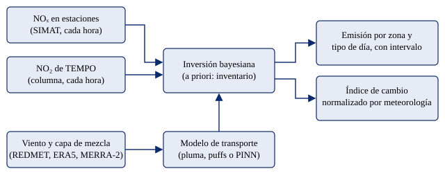

# 1. Antecedentes

## 1.1 El Hub de Ciencia de Datos

El Hub de Ciencia de Datos del Tecnológico de Monterrey, en el Campus Monterrey, es la unidad que recibe la solución de este proyecto. Su interés es contar con métodos reproducibles de ciencia de datos aplicados a problemas reales, con código, datos y documentación que otros equipos puedan reutilizar. El patrocinador del proyecto es el Dr. Juan Arturo Nolazco Flores, Decano asociado de la Escuela de Ingeniería y Ciencias del mismo campus. El proyecto no depende de un convenio de confidencialidad: todas las fuentes de datos son públicas.

## 1.2 Los óxidos de nitrógeno y la salud

Los óxidos de nitrógeno (NOₓ, la suma de NO y NO₂) se forman en procesos de combustión. En una ciudad como la Zona Metropolitana del Valle de México (ZMVM), la fuente dominante es el transporte vehicular. El NO₂ irrita las vías respiratorias y se evalúa en las guías de calidad del aire de la Organización Mundial de la Salud (World Health Organization, 2021). Además, los NOₓ son precursores del ozono y de parte de las partículas finas, dos contaminantes con efectos documentados en la salud. En el Valle de México el ozono está limitado por compuestos orgánicos volátiles (COV), por lo que reducir NOₓ no garantiza reducir el ozono. Por eso, saber si la emisión de NOₓ bajó realmente es la mitad del diagnóstico que necesitan las autoridades ambientales.

## 1.3 La brecha: emisión estimada, concentración medida

Las autoridades de la ZMVM usan hoy cuatro herramientas, y ninguna responde a la pregunta de cuánto se emitió esta semana en una zona concreta (Tabla 1).

Tabla 1. Herramientas actuales y brecha que atiende el proyecto.

| Herramienta | Qué hace | Limitación para evaluar cambios de emisión |
|---|---|---|
| Inventario de emisiones (SEDEMA, edición 2018) | Multiplica la actividad de cada fuente por un factor de emisión; entrega toneladas por año | Es una estimación, no una medición. Sale cada varios años y con retraso (la edición 2018 se publicó en agosto de 2021). No puede decir si una medida aplicada en días concretos cambió la emisión |
| Monitoreo (SIMAT) | Unas 30 estaciones miden concentraciones cada hora | Una concentración mezcla dos factores: cuánto se emite y qué tan ventilado está el aire |
| Pronóstico (AQFS-Mex) | Modelo meteorológico y químico que predice concentraciones | Usa el inventario como entrada, de modo que hereda sus errores: supone las emisiones y no las estima |
| Evaluación de políticas | Estudios que comparan concentraciones antes y después de una medida | Se confunde cuando la meteorología cambia entre los periodos comparados |

Este último punto es crítico para las contingencias ambientales, que se declaran justo en los días de peor ventilación. En el periodo de febrero a mayo de 2024, el NOₓ de la tarde fue casi igual en días de contingencia que en días hábiles normales (17.5 frente a 17.9 ppb). Con solo concentraciones caben dos lecturas, indistinguibles entre sí: las restricciones no redujeron la emisión, o la redujeron pero el aire estaba tan estancado que no se notó. La decisión correcta es opuesta en cada caso. Los estudios clásicos sobre el programa Hoy No Circula, como el de Davis (2008), se basan en concentraciones y por ello enfrentan esta ambigüedad.

La brecha es, entonces, de **medición de la emisión**. Las concentraciones se miden cada hora, pero mezclan emisión y meteorología. La emisión se estima cada varios años mediante inventarios de abajo hacia arriba. Este proyecto propone estimar la emisión de arriba hacia abajo, a partir de lo que se mide en el aire, y separarla del efecto del clima.

## 1.4 Fuentes de datos disponibles

La **Red Automática de Monitoreo Atmosférico (RAMA)** y la **Red de Meteorología y Radiación Solar (REDMET)** forman parte del Sistema de Monitoreo Atmosférico de la Ciudad de México (SIMAT), operado por la Secretaría del Medio Ambiente (SEDEMA). Publican datos horarios de NO, NO₂, NOₓ y otros contaminantes, y de viento y otras variables meteorológicas, en un portal de datos abiertos.

El satélite **TEMPO** (Tropospheric Emissions: Monitoring of Pollution) de la NASA es un instrumento en órbita geoestacionaria que observa Norteamérica de forma repetida durante el día y mide la columna troposférica de NO₂ (Zoogman et al., 2017). Opera desde 2023. Sobre el dominio del proyecto hay entre 12 y 16 escaneos por día que cubren las 12:00 a 17:00 horas locales, con píxeles de unos 2 × 4.5 km. A diferencia de las estaciones, TEMPO observa toda la ciudad, incluida la zona noreste (Ecatepec, Acolman y el aeropuerto AIFA), donde las estaciones casi no llegan.

## 1.5 Problemas inversos y redes neuronales informadas por la física

Estimar la emisión a partir de concentraciones es un **problema inverso**: el problema directo, que calcula las concentraciones que produciría una emisión dada con un viento dado, está bien definido; invertirlo no lo está, porque muchas emisiones distintas pueden explicar los mismos datos. Se resuelve con información a priori y con la estadística bayesiana, que además entrega una incertidumbre (Tarantola, 2005; Rodgers, 2000). La concentración en un receptor es, para una química simple, lineal en la emisión, lo que permite una inversión bayesiana lineal con solución cerrada.

Las **redes neuronales informadas por la física** (PINN, por sus siglas en inglés) incorporan en su función de pérdida una ecuación diferencial, de modo que la red se entrena para satisfacerla además de ajustar datos (Raissi et al., 2019; Karniadakis et al., 2021). En este proyecto la ecuación es la de advección-difusión con decaimiento del NOₓ, y la red aprendida hace de matriz fuente-receptor dentro de la inversión.

## 1.6 Estado del arte

La estimación de emisiones de NOₓ desde el espacio es un campo consolidado: Streets et al. (2013) revisan las capacidades de las restituciones satelitales para este fin, y Beirle et al. (2011) estimaron emisiones y tiempos de vida del NOₓ de megaciudades con observaciones satelitales. TEMPO, al observar cada hora, abre la posibilidad de resolver el ciclo diario y los cambios entre días, algo que los instrumentos de órbita polar, con una sola pasada diaria, no permiten.

Una segunda línea es la **normalización meteorológica** de series de calidad del aire. Grange et al. (2018) ajustan bosques aleatorios de concentración contra meteorología y calendario, y estiman la tendencia con la meteorología fija. Es un enfoque puramente estadístico que da cambios relativos, no toneladas.

Una tercera línea es la modelación química de la atmósfera (Brasseur y Jacob, 2017), de la que se toma la formulación física del transporte y de la vida química del NOₓ.

El proyecto combina estas líneas: una formulación física del transporte, una inversión que da emisión con incertidumbre, una red informada por la física como componente del transporte, y un estimador normalizado por meteorología como salida para reportar cambios. Los modelos puramente estadísticos y los de inversión física se comparan con la misma validación (Sección 3.2).

# 2. Entendimiento del negocio

## 2.1 Formulación del problema

**Problema.** Las autoridades ambientales y los investigadores carecen de una forma frecuente y verificable de saber cuánto cambió la emisión de NOₓ de una zona de la ZMVM entre tipos de día o bajo una restricción vehicular, porque las concentraciones medidas mezclan la emisión con el estancamiento del aire y el inventario solo se publica cada varios años.

**Tarea de aprendizaje automático.** Dados el NOₓ medido por estaciones, el NO₂ de TEMPO y la meteorología (viento y altura de la capa de mezcla), estimar la **emisión de NOₓ por zona y tipo de día** (día hábil, sábado, domingo o festivo), y su cambio, con una incertidumbre. No existen etiquetas de emisión medida: la emisión es la variable latente que se infiere. Estimar emisión es requisito de todo modelo candidato; los métodos que solo interpolan concentración (distancia inversa ponderada, IDW, y kriging) se conservan únicamente como referencias.

**Solución propuesta.** La Figura 1 resume el flujo: las mediciones y la meteorología alimentan un modelo de transporte y una inversión bayesiana, cuya salida es la emisión por zona con intervalo y un índice de cambio normalizado por meteorología.

<figure>

</figure>

Figura 1. Esquema del método: de las mediciones a la emisión por zona y al índice de cambio.

## 2.2 Contexto e importancia

El proyecto es una prueba de concepto para la ZMVM. En la fase de investigación se probó también en Los Ángeles, como control positivo (tiene TEMPO y datos públicos de tráfico), y en Bogotá, como caso sin satélite; su integración al repositorio está planeada. El caso de uso principal es evaluar si bajó la emisión vial cuando se restringió la circulación, es decir, en las contingencias ambientales. Quién decide: la Comisión Ambiental de la Megalópolis y la SEDEMA. Qué decisión: mantener, endurecer o cambiar las restricciones vehiculares. Un caso secundario es verificar entre ediciones del inventario el reparto de la emisión vial por zona.

La importancia está en tres propiedades del método. Mide emisión y no concentración. Es independiente del inventario, que solo da el punto de partida: así puede verificarlo desde fuera. Y es frecuente y barato, porque usa datos públicos y no requiere campañas de medición. No sustituye al inventario: el inventario da el detalle por fuente y el método comprueba sus patrones y detecta cambios.

El alcance es acotado. El método **no** atribuye emisión a una fábrica individual, **no** entrega totales absolutos en toneladas para sustituir el inventario, **no** evalúa el programa Hoy No Circula ordinario (cerca del 4 % del parque vehicular, un efecto por debajo de la resolución) y **no** opera en tiempo real.

## 2.3 Objetivos

**Objetivo general.** Estimar, con modelos informados por la física y la validación necesaria para justificarlos, los cambios de emisión de NOₓ por zona y tipo de día en la ZMVM a partir de estaciones de monitoreo y del satélite TEMPO, con la meteorología descontada y con incertidumbre explícita.

**Objetivos específicos.** Cada uno tiene un criterio medible (Tabla 2).

Tabla 2. Objetivos específicos y criterios de éxito.

| Núm. | Objetivo específico | Criterio medible |
|---|---|---|
| 1 | Construir y documentar un conjunto de datos con calidad verificada para nov–dic 2023 (ajuste) y feb–may 2024 (prueba) | Revisión de calidad documentada por fuente; catálogo de datos con origen, licencia y acceso; datos versionados y reproducibles |
| 2 | Establecer un baseline de inversión bayesiana lineal con pluma estacionaria | Reproducir en nov–dic 2023 las cifras de la fase de investigación: r = 0.77 en estaciones y 0.74 en TEMPO, error al omitir una estación (LOO) de 13.6 ppb y cociente domingo/hábil de 0.42 |
| 3 | Comparar al menos seis modelos con algoritmos distintos que estimen emisión, con la misma validación | Tabla comparativa ordenada por el error LOO (en ppb), con al menos dos métricas adicionales y tiempos de cómputo |
| 4 | Garantizar que ningún modelo elegible invente cambios de emisión | Placebo (días sin cambio de emisión) centrado en 1 ± 0.15 |
| 5 | Estimar con exactitud un cambio de emisión de respuesta conocida | Cociente domingo/hábil con su intervalo de confianza coherente con los conteos de tráfico (0.65–0.73) |
| 6 | Mantener un error de predicción en estaciones ocultas comparable al piso de concentración | LOO no muy por encima del de IDW (11.6 ppb) |
| 7 | Evaluar el modelo final en datos no vistos | Resultados con intervalo en el periodo de prueba feb–may 2024, el confinamiento de 2020 frente a 2019 y las contingencias de 2024 |
| 8 | Comunicar los resultados y sus límites | Producto de difusión (interfaz) y resumen ejecutivo con intervalos, no con cifras puntuales |

## 2.4 Preguntas clave

1. ¿Cuánto cambia la emisión vial de NOₓ de cada zona entre un día hábil, un sábado y un domingo, una vez descontado el efecto del viento y de la capa de mezcla?
2. ¿Bajó la emisión vial en los días de contingencia ambiental frente a días hábiles comparables, y cuánto?
3. ¿Qué aporta TEMPO frente a usar solo estaciones, en cobertura espacial y en reducción de incertidumbre?
4. ¿Qué cambio mínimo de emisión puede detectarse con este método?
5. ¿Una red informada por la física mejora a los métodos de inversión lineal y a los puramente estadísticos, y a qué costo?
6. ¿Qué tan confiable es el resultado: cuándo da dirección, cuándo tamaño y cuándo no da nada?

## 2.5 Fases de CRISP-ML(Q) adaptadas al proyecto

CRISP-ML(Q) es un proceso para proyectos de aprendizaje automático que añade a cada fase un aseguramiento de calidad con riesgos y métricas (Visengeriyeva et al., 2023). La Tabla 3 adapta sus seis fases al proyecto y a los avances del curso.

Tabla 3. Fases de CRISP-ML(Q) adaptadas al proyecto.

| Fase | Actividades en el proyecto | Aseguramiento de calidad | Avance del curso |
|---|---|---|---|
| 1. Entendimiento del negocio y de los datos | Formular el problema, definir objetivos medibles, revisar calidad y cobertura de cada fuente | Criterios de éxito (Tabla 2); revisión de calidad por fuente | Avances 0 y 1 (EDA) |
| 2. Ingeniería de datos | Construir las entradas del modelo: horas válidas, viento, ventilación, zonas, tipo de día, a priori | Corrección documentada de errores (viento 2024); pruebas automáticas del contrato de datos | Avance 2 |
| 3. Ingeniería del modelo | Baseline y modelos alternativos que cumplen un contrato común; ajuste de hiperparámetros | Misma validación para todos (LOO y placebo); cada experimento se configura en un archivo versionado | Avances 3 y 4 |
| 4. Evaluación del modelo | Elegir el modelo final, ensambles y evaluación en datos no vistos | Periodo de prueba reservado (feb–may 2024); pruebas de signo conocido; reglas de publicación | Avance 5 |
| 5. Despliegue | Interfaz de resultados y resumen ejecutivo | La interfaz lee solo resultados exportados y validados | Avances 6 y 7 |
| 6. Monitoreo y mantenimiento | Repetir la estimación al aparecer nuevos datos de TEMPO o una nueva edición del inventario | Propuesto; queda fuera del alcance del curso | Presentación final |

La Tabla 4 enumera los riesgos de calidad ya identificados y su mitigación.

Tabla 4. Riesgos de calidad identificados y mitigación.

| Riesgo | Mitigación |
|---|---|
| La velocidad del viento de REDMET en 2024 está multiplicada por cerca de 2.2 (parece unidades de mph etiquetadas como m/s) | Corrección dividiendo entre 2.237, con el valor original conservado; la corrección está aprobada y documentada |
| Pocas estaciones con NOₓ (entre 14 y 20 válidas por mes) y mediana de 5.6 km entre vecinas | TEMPO como segunda fuente; validación dejando una estación fuera |
| Las nubes y las banderas de calidad descartan buena parte de los píxeles de TEMPO | Usar TEMPO por píxel y no exigir cobertura mínima del dominio |
| El total absoluto depende del modelo de transporte | Reportar cocientes y cambios relativos, no toneladas |
| Fechas de contingencias tomadas de la prensa | Contrastar con los boletines de la CAMe antes de usarlas como resultado final |
| Fuga de información hacia el periodo de prueba | Afinar solo con nov–dic 2023; la herramienta de ajuste rechaza configuraciones que se traslapan con feb–may 2024 |

## 2.6 Involucrados

Tabla 5. Involucrados, roles, etapa y nivel de participación.

| Involucrado | Rol | Etapa | Nivel |
|---|---|---|---|
| Estudiantes (Isabella Arango Restrepo, Manuel Alejandro Vázquez Meza, Isaí Ambrocio) | Ejecutan el proyecto: datos, modelos, evaluación y documentación | Todas | Alto |
| Dr. Juan Arturo Nolazco Flores | Patrocinador; define el problema y valida los resultados; también profesor del curso | Fases 1, 4 y 5 | Alto |
| Guillermo Mota Medina | Profesor; asesora y evalúa los entregables | Todas | Medio |
| Hub de Ciencia de Datos, Tec de Monterrey | Beneficiario; recibe y reutiliza el método, el código y los datos | Despliegue y mantenimiento | Alto |
| SEDEMA y SIMAT (RAMA y REDMET) | Proveedor de datos abiertos de estaciones y del inventario de emisiones; potencial usuario de resultados | Fases 1 y 2 | Bajo (no participa) |
| NASA (ASDC y GES DISC) | Proveedor de datos de TEMPO y de MERRA-2 | Fases 1 y 2 | Bajo (no participa) |
| CAMe y SEDEMA como tomadores de decisión | Usuarios potenciales de las evaluaciones de medidas | Fase 5 | Bajo (no participan) |

Los proveedores de datos y los usuarios potenciales no participan formalmente en el proyecto: sus datos son públicos y no hay convenio con ellos.

# 3. Entendimiento de los datos

## 3.1 Fuentes de datos

**Estaciones de SIMAT.** La RAMA mide NO, NO₂ y NOₓ en partes por mil millones (ppb) cada hora; la REDMET mide viento. La revisión de calidad (QC) encontró que los datos de NOₓ de 2023 y 2024 son aptos (sin duplicados ni negativos, con el pico matutino de 07 a 09 h y menores valores en domingo). Se filtran 59 horas con sensor pegado. El dominio tiene 24 estaciones con NOₓ.

**TEMPO.** Columna troposférica de NO₂ nivel 2, versión V04, recortada al dominio del proyecto (1,068 gránulos de noviembre de 2023 a mayo de 2024, en las horas de la tarde). En nov–dic 2023 la concordancia con las estaciones es r = 0.76 sobre 4,424 pares hora-estación. En el periodo feb–may 2024 baja a r = 0.71, y a r = 0.55 dentro de cada gránulo, por debajo de la meta de 0.6. El 41 % de los píxeles se rechaza por nubes y el 19 % por banderas de calidad.

**Meteorología.** El viento por hora proviene de REDMET y, como respaldo, de los reportes METAR de los aeropuertos MMMX y MMSM. La altura de la capa límite viene de ERA5 y de MERRA-2, y la verificación con radiosondeos de IGRA. La velocidad de REDMET 2024 tiene un error de unidades que se corrige (Tabla 4).

**Red vial y tráfico.** La red vial de OpenStreetMap (autopistas a vías terciarias) distribuye la emisión vial en el espacio, y explica el 71 % del mapa de NO₂ de TEMPO. Los conteos de Infovial dan un perfil semanal de tráfico independiente: el domingo equivale a 0.65–0.73 del día hábil.

**Inventarios y fuentes puntuales.** El inventario de la SEDEMA (edición 2018) da un total de 144,597.8 t/año de NOₓ (cuadro 7 del informe), pero no reporta NOₓ por municipio. EDGAR v8.1 da emisiones por sector en una malla de 0.1°, Climate TRACE da las de las centrales eléctricas, y el DENUE de INEGI los establecimientos industriales. Se usan como a priori y para comparar al final, nunca para ajustar.

**Datos de validación.** Contingencias de 2024 (23 días, tomados de la prensa), movilidad de Google y Apple de 2020, y los casos de Los Ángeles (EPA AQS, HRRR) y Bogotá (RMCAB).

La Tabla 6 resume las fuentes. El catálogo completo, con licencia y tamaño, está en `data/README.md` del repositorio.

Tabla 6. Fuentes de datos: periodo, resolución, formato y acceso.

| Fuente | Periodo | Resolución | Formato | Acceso |
|---|---|---|---|---|
| SIMAT: RAMA (NO, NO₂, NOₓ) y REDMET (viento) | 2019, 2020, 2023, 2024 | Horaria; 24 estaciones con NOₓ en el dominio | CSV comprimido; catálogos en CSV | Datos abiertos de la CDMX (SEDEMA) |
| NASA TEMPO NO₂ L2 V04 | Nov 2023 a may 2024, tardes | Píxel de ~2 × 4.5 km; 12–16 escaneos por día | NetCDF | NASA ASDC; requiere cuenta Earthdata gratuita |
| METAR (MMMX, MMSM) | 2019–2020 y 2023–2024 | Horaria, en el aeropuerto | CSV | IEM ASOS, Iowa State University |
| ERA5 vía Open-Meteo | 2019–2020 y 2023–2024 | Horaria, celda de la CDMX | JSON | API pública, licencia CC BY 4.0 |
| MERRA-2 (altura de capa límite) | Ene 2023 a jun 2024 | Horaria, 3 × 3 celdas | NetCDF4 | NASA GES DISC; requiere cuenta Earthdata |
| Radiosondeos IGRA v2 | Registro completo | Estación 76679 del aeropuerto | Texto de ancho fijo | NOAA NCEI, público |
| OpenStreetMap, red vial | Captura del 2026-10-19 | Vías de autopista a terciaria | JSON | API Overpass; licencia ODbL |
| Infovial, conteos vehiculares | Ene 2017 | Por vía, sentido, hora y tipo de vehículo | CSV | Datos abiertos de la CDMX |
| Inventario de emisiones ZMVM (SEDEMA) | 2018 | Total anual por fuente | PDF | Informe público de la SEDEMA |
| EDGAR v8.1 | 2018 y 2022 | Malla de 0.1°, por sector | ZIP y NetCDF | JRC; licencia CC BY 4.0 |
| Climate TRACE (centrales eléctricas) | 2021–2026 | Mensual, por instalación | ZIP y CSV | Climate TRACE; licencia CC BY 4.0 |
| DENUE (INEGI) | Corte de mayo de 2026 | Por establecimiento | CSV comprimido | INEGI, términos de libre uso |
| Contingencias 2024 | 2024 | Fechas (23 días) | CSV | Compilado por el equipo desde la prensa; pendiente de contrastar con la CAMe |

Los resultados preliminares de la fase de investigación, obtenidos antes de la evaluación formal en el periodo de prueba, muestran la viabilidad del método (Tabla 7).

Tabla 7. Resultados preliminares de la fase de investigación (no son resultados finales).

| Prueba | Resultado | Referencia o criterio |
|---|---|---|
| Baseline, ajuste en muestra, nov–dic 2023 | r = 0.77 en estaciones y 0.74 en TEMPO | Hay señal en ambos instrumentos |
| Error LOO: baseline, IDW e híbrido | 13.6, 11.6 y 11.7 ppb | IDW es el piso de concentración |
| Domingo/hábil, inversión completa | 0.42 (IC 90 %: 0.35–0.54) | Tráfico contado: 0.65–0.73; la inversión exagera la baja |
| Domingo/hábil, estimador normalizado | 0.65 (IC 90 %: 0.55–0.75) | Coherente con el tráfico contado |
| Placebo de días al azar | Entre ±10 % y ±20 % | Criterio de elegibilidad: 1 ± 0.15 |
| Confinamiento de 2020 | Baja de 41–42 % con la configuración estándar | Esperado: baja de 40–60 % |
| Contingencias 2024 (23 días) | Sin baja de emisión de NOₓ ni de CO | Pendiente de contrastar las fechas con la CAMe |
| Total absoluto | No confiable: entre 40 % y 100 % del inventario según la configuración | Por eso se reportan cocientes |

Las limitaciones conocidas son que la inversión no da fuentes industriales individuales (su señal es unas 100 veces menor que la vial de su región), que el viento es el error dominante, y que los cambios menores a 10–20 % no se distinguen. En la práctica, el método detecta cambios relativos grandes (≥ 20 %) de la emisión vial por zona entre grupos de días.

## 3.2 Técnica de aprendizaje automático

**Formulación.** Para cada hora, la concentración observada y (en estaciones y en píxeles de TEMPO) se relaciona con la emisión e de cada zona mediante una matriz de transporte J que depende del viento y de la capa de mezcla: y = J e + b + ε, donde b es el fondo horario y ε el error. Con un a priori gaussiano de la emisión, e ~ N(e₀, Σ₀), la solución es la media posterior ê = e₀ + Σ₀Jᵀ (JΣ₀Jᵀ + R)⁻¹ (y − Je₀), con covarianza posterior que cuantifica la incertidumbre, donde R es la covarianza del error. El inventario solo fija e₀, igual para todos los tipos de día, de modo que cualquier diferencia entre tipos de día sale de los datos.

**Técnica propuesta.** Un **problema inverso informado por la física**: la inversión bayesiana lineal como base (baseline), con transporte de pluma estacionaria o de puffs con vida química, y una PINN que aprende el núcleo de transporte a partir de la ecuación de advección-difusión sin ver datos de estaciones. Como la PINN se entrena solo con la física, no puede filtrar información de una estación retenida durante la validación. Se justifica porque (a) el objetivo es estimar emisión y no hay etiquetas de emisión; (b) hay pocos datos (unas 24 estaciones); (c) da incertidumbre; (d) es interpretable, con un factor por zona; y (e) separa la emisión del clima, porque el modelo sabe qué tan ventilada estuvo cada hora.

**Alternativas basadas en datos.** Se incluyen modelos puramente estadísticos para contrastar: la normalización meteorológica con bosque aleatorio (Grange et al., 2018) y el estimador normalizado, que dan cambios relativos sin necesitar un modelo de transporte. Los métodos de interpolación (IDW, kriging) se conservan como referencias que fijan el piso de concentración.

La Tabla 8 compara las técnicas. Todos los modelos cumplen el mismo contrato, de modo que se evalúan con la misma validación: se omite una estación (LOO), se aplican placebos y se usa un periodo de prueba reservado.

Tabla 8. Comparación de las técnicas consideradas.

| Técnica | Emisión que estima | Ventajas | Limitaciones |
|---|---|---|---|
| Inversión bayesiana lineal con pluma estacionaria (baseline) | Absoluta por zona y tipo de día | Solución cerrada, rápida (~30 s por ajuste), con incertidumbre e interpretable | Transporte estacionario; exagera la baja dominical |
| Inversión con puffs y vida química por OH | Absoluta | Sigue la emisión hora por hora; mejora el ajuste regional (TEMPO r = 0.83 en la investigación) | Más costosa de calcular que la pluma estacionaria |
| Mínimos cuadrados regularizados (ridge y no negativos) | Absoluta | Sin supuesto bayesiano; simple | Sin incertidumbre propia; la penalización fija el resultado |
| Inversión log-normal (máximo a posteriori) | Absoluta, siempre positiva | Evita emisiones negativas | Solución no lineal y aproximación de Laplace para la incertidumbre |
| PINN (núcleo de pluma, puffs o entrenamiento conjunto) | Absoluta | Aprende el transporte de la ecuación; sin fuga de datos | Entrenar tarda minutos; viento uniforme por hora y estado estacionario; el nivel absoluto no es comparable al de la pluma gaussiana (25–40 %) |
| Normalización meteorológica con bosque aleatorio | Relativa (índice por tipo de día) | No depende de un modelo de transporte; frecuente en la literatura | Solo cambios, sin toneladas; no resuelve zonas; se atenúa hacia 1 con pocos datos |
| Estimador normalizado (observado ÷ esperado) | Relativa | Cancela buena parte del sesgo de escala; la salida que se reporta | Depende del modelo de transporte para el esperado |
| IDW y kriging (referencias) | No estiman emisión | Piso de concentración (IDW: 11.6 ppb) | No pueden responder la pregunta; no son candidatos |

El modelo final se elige con la métrica principal (el error al predecir una estación oculta, en ppb), la exactitud del cambio de emisión y los placebos, y además se consideran la interpretabilidad, la incertidumbre, si da emisión absoluta o solo relativa, y el costo. Un modelo cuyo placebo queda fuera de 1 ± 0.15 no es elegible, aunque tenga buen error.

## 3.3 Variables

La Tabla 9 lista las variables de entrada y de salida del modelo.

Tabla 9. Variables de entrada y de salida.

| Tipo | Variable | Unidad | Fuente | Comentario |
|---|---|---|---|---|
| Entrada | NOₓ en estaciones | ppb | SIMAT (RAMA) | Horaria, por estación; horas de 12 a 17 h locales con datos y viento |
| Entrada | Columna de NO₂ de TEMPO y su incertidumbre | molécula/cm² | NASA TEMPO | Por píxel; sin píxeles nublados |
| Entrada | Viento (componentes u y v) | m/s | REDMET y METAR | Horaria; piso de 2 m/s y ensamble de dirección |
| Entrada | Altura de la capa límite | m | ERA5, MERRA-2 | Horaria |
| Entrada | Red vial | Vías por clase | OpenStreetMap | Reparte la emisión vial en el espacio |
| Entrada | A priori de emisión (inventario y fuentes puntuales) | t/año | SEDEMA 2018, EDGAR, Climate TRACE, DENUE | Solo punto de partida y comparación final |
| Entrada | Calendario: tipo de día (hábil, sábado, domingo o festivo) y hora | Categórica | Calendario | Define los grupos de días comparados |
| Salida | Emisión de NOₓ por zona y tipo de día, con incertidumbre | t/año | Modelo | Zonas: 13 grupos de alcaldías y municipios (la base usa una malla 3 × 3) |
| Salida | Índice de cambio de emisión por tipo de día (y zona, si es posible) con intervalo | Cociente | Modelo | Domingo/hábil, contingencia/hábil |
| Salida | NOₓ predicho en estaciones ocultas | ppb | Modelo | Para validación (LOO) |

# Bibliografía

Beirle, S., Boersma, K. F., Platt, U., Lawrence, M. G., & Wagner, T. (2011). Megacity emissions and lifetimes of nitrogen oxides probed from space. *Science, 333*(6050), 1737–1739. https://doi.org/10.1126/science.1207824

Brasseur, G. P., & Jacob, D. J. (2017). *Modeling of atmospheric chemistry*. Cambridge University Press.

Davis, L. W. (2008). The effect of driving restrictions on air quality in Mexico City. *Journal of Political Economy, 116*(1), 38–81.

Grange, S. K., Carslaw, D. C., Lewis, A. C., Boleti, E., & Hueglin, C. (2018). Random forest meteorological normalisation models for Swiss PM₁₀ trend analysis. *Atmospheric Chemistry and Physics, 18*(9), 6223–6239. https://doi.org/10.5194/acp-18-6223-2018

Karniadakis, G. E., Kevrekidis, I. G., Lu, L., Perdikaris, P., Wang, S., & Yang, L. (2021). Physics-informed machine learning. *Nature Reviews Physics, 3*(6), 422–440. https://doi.org/10.1038/s42254-021-00314-5

Raissi, M., Perdikaris, P., & Karniadakis, G. E. (2019). Physics-informed neural networks: A deep learning framework for solving forward and inverse problems involving nonlinear partial differential equations. *Journal of Computational Physics, 378*, 686–707. https://doi.org/10.1016/j.jcp.2018.10.045

Rodgers, C. D. (2000). *Inverse methods for atmospheric sounding: Theory and practice*. World Scientific.

Secretaría del Medio Ambiente de la Ciudad de México. (2021). *Inventario de emisiones de la Zona Metropolitana del Valle de México 2018*. https://www.sedema.cdmx.gob.mx/storage/app/media/DGCA/InventarioDeEmisionesZMVM2018.pdf

Streets, D. G., Canty, T., Carmichael, G. R., de Foy, B., Dickerson, R. R., Duncan, B. N., Edwards, D. P., Haynes, J. A., Henze, D. K., Houyoux, M. R., Jacob, D. J., Krotkov, N. A., Lamsal, L. N., Liu, Y., Lu, Z., Martin, R. V., Pfister, G. G., Pinder, R. W., Salawitch, R. J., & Wecht, K. J. (2013). Emissions estimation from satellite retrievals: A review of current capability. *Atmospheric Environment, 77*, 1011–1042. https://doi.org/10.1016/j.atmosenv.2013.05.051

Tarantola, A. (2005). *Inverse problem theory and methods for model parameter estimation*. Society for Industrial and Applied Mathematics.

Visengeriyeva, L., Kammer, A., Bär, I., Kniesz, A., & Plöd, M. (2023). *CRISP-ML(Q): The ML lifecycle process*. MLOps. https://ml-ops.org/content/crisp-ml

World Health Organization. (2021). *WHO global air quality guidelines: Particulate matter (PM2.5 and PM10), ozone, nitrogen dioxide, sulfur dioxide and carbon monoxide*. World Health Organization.

Zoogman, P., Liu, X., Suleiman, R. M., Pennington, W. F., Flittner, D. E., Al-Saadi, J. A., Hilton, B. B., Nicks, D. K., Newchurch, M. J., Carr, J. L., Janz, S. J., Andraschko, M. R., Arola, A., Baker, B. D., Canova, B. P., Chan Miller, C., Cohen, R. C., Davis, J. E., Dussault, M. E., … Chance, K. (2017). Tropospheric emissions: Monitoring of pollution (TEMPO). *Journal of Quantitative Spectroscopy and Radiative Transfer, 186*, 17–39. https://doi.org/10.1016/j.jqsrt.2016.05.008
