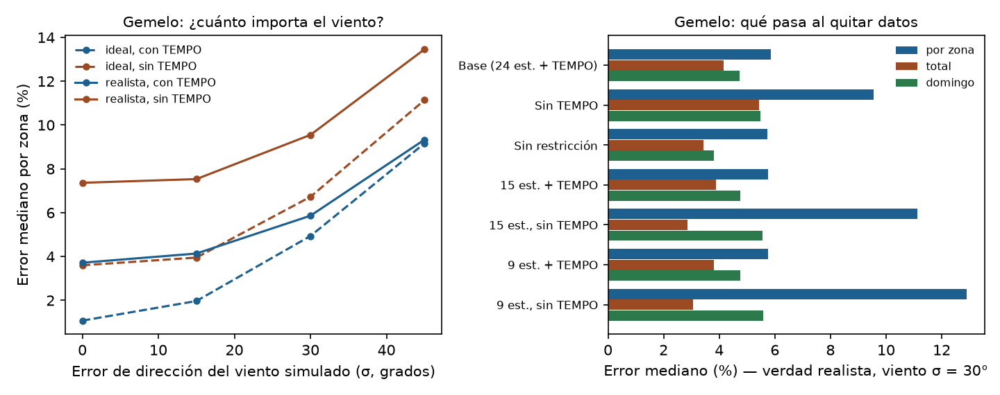
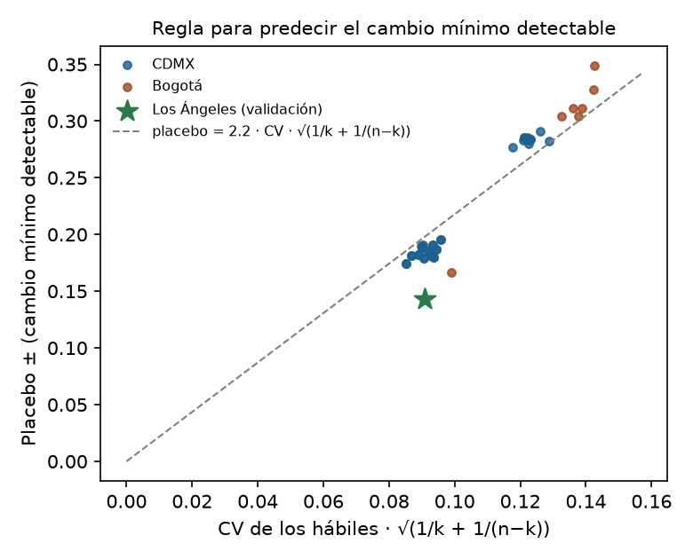

# Banco de datos frente a desempeño: CDMX, Los Ángeles y Bogotá

Fecha: 2026-10-23. Este reporte mide **cuánto pesa cada tipo de dato** en el resultado, quitándolo o degradándolo a propósito. Así se puede comparar ciudades con datos distintos y anticipar cómo le iría al método en una ciudad nueva a partir de su "ficha de datos".

Se midió de tres formas:
1. **Ficha de datos por ciudad:** qué tiene cada una.
2. **Gemelos:** se inventa la verdad y se quitan datos.
3. **Datos reales de la CDMX:** se quitan o empeoran datos y se ve qué se pierde.

Al final hay una regla simple para predecir el cambio mínimo detectable en una ciudad nueva.

**Configuración usada** (registrada en cada resultado):
- zonas `admin_grupos` (13);
- puffs con el viento del dominio;
- σθ = 30°;
- TEMPO ×1/3;
- restricción de cociente de Infovial;
- a priori de centrales de Climate TRACE;
- nov–dic 2023.

Sobre la vida química: `reports/vida_quimica.md` todavía no existía al correr, así que se usó la vigente, **constante de 4 h con puffs de 6 h** (`fija4_6h`). Con ella, la base reproduce las cifras de `zonas_admin.md` y `edgar.md`: híbrido 11.8 ppb, domingo restringido 0.65 y Spearman con EDGAR 0.75. Esto confirma que la reimplementación del banco es correcta.

## Resumen

- **El dato que más pesa para medir cambios es el modelo de transporte, no el número de estaciones ni el viento.**
  - El cambio mínimo detectable con el estimador normalizado pasa de ±0.28 sin modelo (caja 1/(viento·capa límite)) a ±0.19 con puffs.
  - Con 24, 15 o 9 estaciones apenas cambia (±0.18–0.19).
  - Con el viento degradado otros 20–30°, no cambia.
- **Para el reparto por zonas, el satélite pesa más que las estaciones.**
  - Con TEMPO, bajar de 24 a 9 estaciones casi no cambia el error fuera de muestra (13.2 frente a 12.7 ppb de referencia) ni el patrón frente a EDGAR (Spearman 0.80).
  - Sin TEMPO el error sube a 15.0–15.3 ppb y el patrón se pierde (Spearman 0.40–0.42).
  - Los gemelos coinciden: sin TEMPO el error por zona se duplica (6 % → 11–13 %) y las zonas se confunden entre sí (|corr| hasta 0.6).
- **Los gemelos sobrevaloran el viento; los datos reales no lo confirman.**
  - En el gemelo, pasar de 30° a 45° de error sube el error por zona de 6 % a 9 %.
  - Con datos reales, degradar el viento de la CDMX otros 20–30° no cambia ninguna métrica.
  - Es lo mismo que mostró Los Ángeles: con HRRR, el mejor viento no mejoró nada (`otras_ciudades.md`).
- **La referencia de tráfico manda en el cociente domingo/hábil de la inversión.**
  - Sin ella, el domingo de la inversión cae a 0.48; con ella, 0.65.
  - Sin TEMPO, sube a 0.65 por sí solo, porque es TEMPO el que lo jala hacia abajo.
  - En el gemelo, el error del domingo ≈ el error de la referencia (5 % si Infovial se equivoca 8 %).
- **Regla para una ciudad nueva:** cambio mínimo detectable ≈ **2 · CV · √(1/k + 1/(n − k))**.
  - CV = variación día a día del estimador en hábiles; k = domingos; n = hábiles.
  - Ajusta a CDMX y Bogotá con error mediano de 6 %.
  - En Los Ángeles, que no se usó en el ajuste, predice ±0.20 y se midió ±0.14: la regla es **conservadora**.
  - El CV lo fija sobre todo la calidad del modelo de transporte: 0.34–0.40 con caja, 0.29 solo con viento, 0.25–0.26 con puffs.

## 1. Fichas de datos

`data/interim/fichas_datos.json` (`scripts/benchmark_fichas.py`).

| | CDMX | Los Ángeles | Bogotá |
|---|---|---|---|
| Estaciones de NOₓ en la inversión | 24 (+3 solo de NO₂) | 9 | 15 (17 con NOₓ; 15 con ≥ 86 % de datos) |
| Densidad (por 1,000 km² del dominio) | 7.4 (3,260 km²) | 2.9 (3,080 km²) | 39.5 (zona urbana, ~380 km²) |
| Distancia al vecino más cercano (mediana) | 6.2 km | 14.3 km | 3.9 km |
| Satélite | TEMPO horario (~214 píxeles por escaneo) | TEMPO horario (~140 píxeles por escaneo) | Ninguno horario. TROPOMI, una pasada diaria, nublado; no integrado |
| Error de dirección del viento (validación cruzada, tarde): vector medio / IDW / modelo | 32° / 28° | 30° / 17° / 17° (HRRR 3 km) | 33° / 32° (calculado aquí con 12 estaciones RMCAB) |
| Referencia de tráfico | Infovial (2017), 26 vialidades, horaria por clase | Ninguna integrada (PeMS sin cuenta; EMFAC en proceso) | Secretaría de Movilidad (2019–2020), sin verificar |
| Capa límite | ERA5 + MERRA-2 corregido | HRRR / ERA5 | ERA5; en Bogotá **empeora** la normalización (`bogota.md`) |
| Inventario | SEDEMA 2018 por entidad; EDGAR v8.1 0.1° | EDGAR v8.1 (CARB pendiente) | SDA 2023 (resolución sin verificar); EDGAR v8.1 |

Puntos clave:
- **Estaciones:** Bogotá tiene la red más densa. LA la más rala, con 9 estaciones separadas 14 km.
- **Viento:** solo LA tiene un viento bien resuelto. En Bogotá, como en la CDMX, interpolar estaciones no mejora el vector medio, porque la sabana y los cerros cortan el flujo.

## 2. Gemelos: qué pasa al quitar datos

`scripts/benchmark_twin.py` → `data/interim/benchmark/twin.json`. Cada fila es la mediana de 40 verdades.

**Dos verdades:**
- **Ideal:** α por zona; solo el viento tiene error.
- **Realista:** α distinto por **municipio**, que es error de distribución espacial dentro de cada zona. Además:
  - la referencia de tráfico se equivoca ~8 %;
  - hay un gradiente de fondo de ±2 ppb (y ±10¹⁵ en TEMPO) por 20 km que la inversión no representa.

Las observaciones se generan con el viento rotado σ grados y se invierten con el viento sin rotar.

| Verdad realista, σ = 30° | Error por zona (p90) | Error total | Error domingo | Error CDMX/Edomex | \|corr\| máx. entre zonas |
|---|---|---|---|---|---|
| Base: 24 estaciones + TEMPO + restricción | 6 % (15 %) | 4 % | 5 % | 4 % | 0.28 |
| Sin TEMPO | 10 % (25 %) | 5 % | 5 % | 4 % | 0.21 |
| Sin restricción de tráfico | 6 % (16 %) | 3 % | 4 % | 5 % | 0.30 |
| 15 estaciones + TEMPO (media de 5) | 6 % | 4 % | 5 % | — | 0.33 |
| 15 estaciones, sin TEMPO | 11 % | 3 % | 6 % | — | 0.51 |
| 9 estaciones + TEMPO | 6 % | 4 % | 5 % | — | 0.33 |
| 9 estaciones, sin TEMPO | 13 % | 3 % | 6 % | — | 0.57 |

| Viento simulado σ | 0° | 15° | 30° | 45° |
|---|---|---|---|---|
| Error por zona, realista con TEMPO | 4 % | 4 % | 6 % | 9 % |
| Error por zona, realista sin TEMPO | 7 % | 8 % | 10 % | 13 % |
| Error por zona, ideal con TEMPO | 1 % | 2 % | 5 % | 9 % |

**Lectura:**
- **El satélite** es lo que más separa unas zonas de otras: sin él, el error por zona se duplica y las zonas se correlacionan más.
- **Las estaciones** casi no importan mientras haya TEMPO. Sin TEMPO, cada estación cuenta.
- **El total y el domingo** dependen poco de los datos. El domingo con restricción hereda el error de la referencia de tráfico (5 %).
- **La verdad realista** quita el optimismo del gemelo ideal cuando el viento es bueno (1 % → 4 %): los errores de distribución y de fondo ponen un piso que un mejor viento no baja.
- **Aun así, el gemelo es optimista.** No incluye el error estructural del modelo de transporte, que con datos reales domina. El error fuera de muestra real es de ~13 ppb, contra el ruido de 15 ppb supuesto.

Tablas completas, incluida la verdad ideal: `data/interim/benchmark/tablas.md`.

## 3. Datos reales de la CDMX: qué se pierde al quitar o empeorar datos

`scripts/benchmark_real.py` → `data/interim/benchmark/real.json`.
- **Fuera de muestra:** con la red completa es LOO. Con subconjuntos, son las estaciones no usadas, y la referencia es el LOO de la red completa en esas mismas estaciones.
- **Placebo ±:** medio ancho 5–95 % de hábiles falsos como domingos, es decir, el cambio mínimo detectable del estimador normalizado.

| Configuración | Fuera de muestra: modelo / IDW / híbrido (ppb) | Normalizado domingo (IC 90 %) | Placebo ± | CV hábiles | Domingo inversión: libre / con restricción | Vial / a priori | Spearman con EDGAR |
|---|---|---|---|---|---|---|---|
| Base | 13.1 / 11.5 / 11.8 | 0.61 (0.53–0.69) | ±0.19 | 0.26 | 0.48 / 0.65 | 77 % | 0.75 |
| Sin TEMPO | 13.6 / 11.5 / 12.4 | igual | ±0.19 | 0.26 | 0.65 / 0.69 | 86 % | 0.59 |
| Sin restricción | 13.1 / 11.5 / 11.9 | igual | ±0.19 | 0.26 | 0.48 / — | 80 % | 0.75 |
| Viento + 20° de error (~36° total) | 13.1 / 11.5 / 11.8 | 0.61 | ±0.19 | 0.26 | 0.47 / 0.65 | 76 % | 0.77 |
| Viento + 30° de error (~42° total) | 13.1 / 11.5 / 11.7 | 0.61 | ±0.19 | 0.25 | 0.45 / 0.65 | 74 % | 0.77 |
| Sin modelo de transporte (caja 1/(U·H)) | — | 0.70 | **±0.28** | 0.34 | — | — | — |

| Subconjuntos (media de 5; rango) | Fuera de muestra: modelo / híbrido | Referencia red completa: modelo / híbrido | Placebo ± | Domingo libre | Spearman con EDGAR |
|---|---|---|---|---|---|
| 15 estaciones + TEMPO | 13.0 (11.2–14.1) / 12.3 | 12.8 / 11.7 | ±0.19 | 0.48 | 0.77 (0.71–0.83) |
| 15 estaciones, sin TEMPO | 15.0 (12.7–18.7) / 14.6 | 12.8 / 11.7 | ±0.19 | 0.62 | 0.40 (0.09–0.71) |
| 9 estaciones + TEMPO | 13.2 (12.8–13.8) / 12.3 | 12.7 / 11.4 | ±0.18 | 0.48 | 0.80 (0.76–0.82) |
| 9 estaciones, sin TEMPO | 15.3 (13.7–17.7) / 15.0 | 12.7 / 11.4 | ±0.18 | 0.66 | 0.42 (0.30–0.51) |
| Caja, 15 o 9 estaciones | — | — | ±0.28 | — | — |

**Lectura:**
- **Estaciones:** con TEMPO, 9 estaciones bien repartidas predicen las no usadas casi igual que la red completa: +0.5 ppb en el modelo y +0.9 en el híbrido. Sin TEMPO se pierden 2–3 ppb, y el patrón por zona deja de coincidir con EDGAR.
- **Viento:** empeorarlo no cambia nada medible. En la CDMX el viento no es el cuello de botella, igual que en LA.
- **Transporte:** es lo que fija la precisión del estimador normalizado. La caja da un placebo 50 % más ancho (±0.28 frente a ±0.19) y un domingo sesgado hacia arriba (0.70).
- **TEMPO y el domingo:** TEMPO jala hacia abajo el domingo de la inversión libre (0.48 con TEMPO, 0.62–0.66 sin él). Es el efecto conocido de `fondo_tempo.md`; la restricción de tráfico lo neutraliza.

**LA, degradación inversa:** no se corrió una nueva; habría que reconstruir sus Jacobianos. Lo equivalente a "quitar HRRR" ya está medido en `otras_ciudades.md`: con puffs, el viento del dominio, IDW y HRRR dan el mismo LOO (13.3–13.5) y el mismo placebo (±0.14–0.16).

## 4. Las tres ciudades lado a lado

Estimador normalizado, domingo frente a hábil, nov–dic 2023, tardes.

| Ciudad | Modelo con emisión fija | Domingo (IC 90 %) | Referencia de tráfico | Placebo ± | CV hábiles | Domingos / hábiles |
|---|---|---|---|---|---|---|
| CDMX | Puffs, 24 estaciones + TEMPO | 0.61 (0.53–0.69) | 0.65–0.73 (Infovial) | ±0.19 | 0.26 | 11 / 41 |
| CDMX | Caja 1/(U·H) | 0.70 | 0.65–0.73 | ±0.28 | 0.34 | 11 / 41 |
| Los Ángeles | Puffs, 9 estaciones + TEMPO | 0.52 (0.44–0.59) | ~0.66 fin de semana (CalNex 2010) | ±0.14 | 0.25 | 10 / 41 |
| Bogotá | Caja 1/(U·H), 14 estaciones | 0.55 | — | ±0.31 | 0.40 | 13 / 39 |
| Bogotá | Solo viento 1/U, 14 estaciones | 0.63 (0.56–0.70) | — | **±0.17** | 0.29 | 13 / 39 |
| Bogotá | Caja, 9 estaciones (media de 5) | 0.54 | — | ±0.32 | 0.41 | 13 / 39 |

`scripts/benchmark_bogota.py` → `data/interim/benchmark/bogota.json`. Festivos colombianos tratados como domingo.

Con un modelo de transporte razonable, las tres ciudades quedan en el mismo rango de detección para un periodo de dos meses (±0.14–0.19). Bogotá llega ahí **sin satélite**, solo normalizando por viento, porque la capa límite de ERA5 le agrega ruido. Esto coincide con el Día sin carro (`bogota.md`): placebo del día ±9 % solo con viento y ±17 % con capa límite, combinando 10 eventos.

## 5. Qué dato vale más en cada ciudad

| Ciudad | 1.º | 2.º | 3.º | Vale poco hoy |
|---|---|---|---|---|
| **CDMX** | Modelo de transporte: puffs; siguiente, capa límite de dos capas (`multifisica.md`) | TEMPO, para el reparto por zonas | Referencia de tráfico reciente (aforos SEMOVI/C5) | Más estaciones (con TEMPO) y mejor viento de superficie |
| **Los Ángeles** | Referencia de tráfico (PeMS/EMFAC): hoy la inversión no tiene restricción | Más estaciones de NOₓ (9, a 14 km): el híbrido no le gana a su propio modelo | — (ya tiene TEMPO y buen viento) | HRRR frente a viento simple |
| **Bogotá** | Transporte con el viento de sus estaciones (puffs) en lugar de la caja con ERA5 | Un sustituto del satélite para el reparto espacial: su red densa compensa en parte, pero el gemelo muestra que sin satélite el error por zona se duplica | Tráfico reciente y el trazador CO (el Día sin carro se ve en CO, no en NOₓ) | Capa límite de ERA5 (la empeora) |

## 6. Regla para una ciudad nueva

**Cambio mínimo detectable** (placebo ±, periodo con k domingos y n hábiles):

> **placebo ≈ c · CV · √(1/k + 1/(n − k))**, con c ≈ 2.2 (ajustado) o 2 como regla redonda.

**Ajuste:** 43 configuraciones de CDMX y Bogotá, con error mediano de 6 % y máximo de 23 %.

**Validación fuera del ajuste en Los Ángeles:** predice ±0.20 y se midió ±0.14.
- La regla es **conservadora**: el c propio de LA es ~1.6.
- Lo más probable es que la distribución de días de LA tenga colas más delgadas.
- Usar c = 2 con ±30 %.

**El CV se lee de la ficha:**

| Modelo con emisión fija disponible | CV típico | Placebo para 2 meses (k ≈ 11, n ≈ 41) |
|---|---|---|
| Ninguno (concentración cruda) | 0.33–0.42 | ±0.23–0.30 |
| Caja 1/(viento · capa límite de reanálisis) | 0.34–0.40 | ±0.24–0.30 |
| Solo viento de estaciones (cuenca sin buena capa límite) | ~0.29 | ~±0.20 |
| Puffs con viento de estaciones y capa límite | 0.25–0.26 | ±0.15–0.19 |

**Otros factores:**
- **Estaciones:** influyen poco en el CV. Con 9 a 24 en la CDMX, o 9 a 14 en Bogotá, cambia menos de 0.02.
- **Periodo:** con un periodo más largo, el término √(1/k + 1/(n − k)) baja. Cuatro meses en lugar de dos reducen el placebo ~30 %.
- **Satélite y estaciones:** no entran en esta regla, porque el estimador normalizado usa solo estaciones. Importan para el **reparto por zonas**:
  - con satélite horario, ~9 estaciones bastan;
  - sin satélite, el error por zona del gemelo se duplica y conviene una red densa, como la de Bogotá.

## Limitaciones

- **Vida química:** se usó la vida constante de 4 h. Si `vida_quimica.md` adopta la vida por OH, hay que volver a correr `benchmark_real.py --variante <la adoptada>`. Se esperan pocos cambios en un mismo periodo de invierno.
- **El gemelo es optimista** frente a los datos reales, porque no tiene error estructural de transporte. Sirve para comparar degradaciones entre sí, no para dar el error absoluto.
- **Bogotá:** usa la caja o solo viento, no puffs. Su CV con puffs está sin medir.
- **LA:** su placebo viene de su configuración de puffs (`la_estandar_zonas_tp3.json`), sin vida química por temporada.
- **El subconjunto de estaciones es al azar.** Una red mal repartida, por ejemplo sin estaciones en el noreste, podría perder más que lo medido.

## Archivos

| Tipo | Archivos |
|---|---|
| Scripts | `scripts/benchmark_common.py`, `benchmark_fichas.py`, `benchmark_twin.py`, `benchmark_real.py`, `benchmark_bogota.py`, `benchmark_report.py` |
| Datos | `data/interim/fichas_datos.json`, `data/interim/benchmark/{twin,real,bogota}.json`, `tablas.md`, `cache/` (Jacobianos del gemelo) |
| Figuras | `reports/figs/banco_gemelos.png`, `reports/figs/banco_regla.png` |
